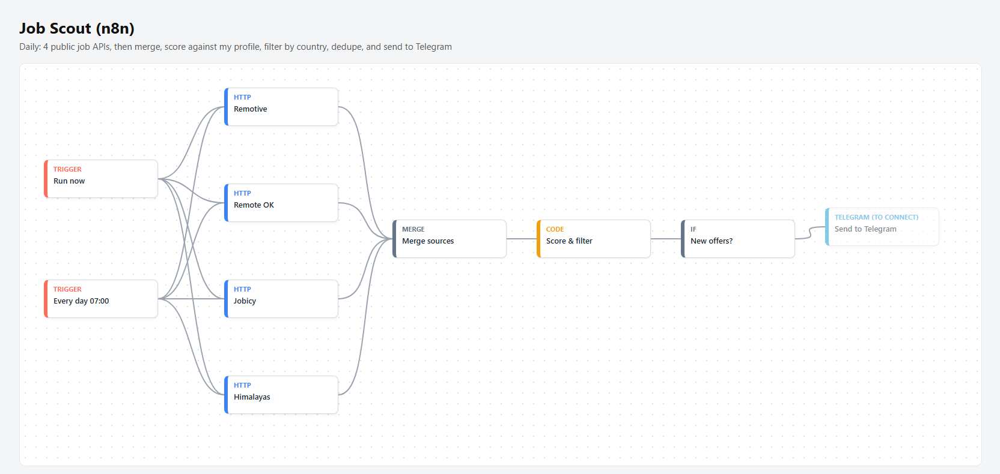

# Job Scout: daily remote job digest (n8n)

## What it does
Every morning at 07:00 (Abidjan time), the workflow:

1. Calls 4 public job APIs in parallel: Remotive, Remote OK, Jobicy and Himalayas.
2. Merges the results into one list (about 230 offers per run).
3. Scores each offer against my profile in a JavaScript Code node. Keywords cover n8n and AI automation, AI training, video and motion, and digital marketing. Senior and manager roles lose points. So do offers that need phone calls or fluent spoken English.
4. Drops offers limited to a specific country or city, and keeps "worldwide", "anywhere" and "Africa" offers.
5. Runs safety checks on each offer:
   - It drops offers that ask you to pay to apply, and offers that are expired.
   - It flags and pushes down suspicious offers: contact through WhatsApp or Telegram only, requests for bank or ID details, unpaid test work, crypto-only payment, pay that looks too good to be true, or a recruiter using a Gmail or Yahoo address.
   - It notes whether PayPal is mentioned, or whether the payment method needs checking.
6. Removes offers already sent in the last 30 days, using workflow static data.
7. Sends the top 8 to Telegram as one formatted message with a link to each offer.

## Why
I look for remote, part-time work that I can do from Côte d'Ivoire. Most "remote" offers are in fact limited to the US or the EU. This workflow saves me from reading hundreds of offers every day and shows only the ones I can really apply to.

## Design choices
- **Public APIs only.** No scraping behind logins and no bypassing anti-bot protection.
- **Resilient sources.** Each HTTP node retries once and continues on error, so one source being down does not stop the run.
- **Manual runs never hide offers.** Only scheduled runs mark offers as "sent", so testing does not hide offers from the next digest.
- **Failure alerts.** A separate error workflow (`error-alert.json`) is set as the workflow's "Error workflow". If a run fails, it sends me the workflow name, the failed node, the error message and a link to the execution on Telegram. A "Test alert" button sends a sample alert to check the setup.
- **Human in the loop.** The workflow never applies to a job. It only reports.

## Test result (3 November 2026, live run in n8n 2.44.5)
230 offers were scanned and 5 were kept after scoring and the country filter. Running it a second time manually still showed the same offers, as intended. The Telegram digest and the test alert were both delivered. The safety rules were tested on 5 sample offers: the pay-to-apply and expired ones were dropped, the WhatsApp-only and Gmail ones were flagged, and the clean PayPal one ranked first. No real offer was flagged by mistake.

## How to use
1. Import `job-scout.json` in n8n.
2. Open "Send to Telegram", add a Telegram credential (bot token from @BotFather) and your chat ID, then enable the node.
3. Activate the workflow.
4. Change the keywords or the minimum score at the top of the "Score & filter" Code node.

Node types used: Manual and Schedule triggers, Error Trigger, HTTP Request, Merge (4 inputs), Code (JavaScript), IF, Telegram.
