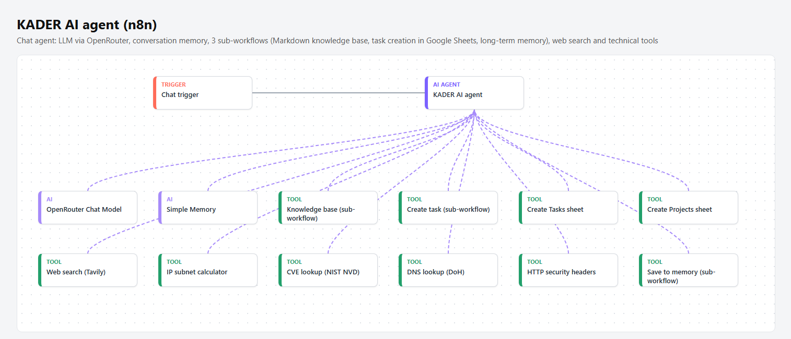

# KADER AI: personal AI agent with tools and memory (n8n)

## What it does
KADER AI is a chat assistant that I built and self-host in n8n (Docker). It helps me with technical questions (networks, IT administration, defensive security) and organises my tasks.

- **LLM:** a chat model through OpenRouter, with a 20-message conversation memory.
- **Knowledge base (sub-workflow):** reads my Markdown reference files (profile, projects, methods, tools) from a mounted folder. The agent uses them only when the question needs personal context.
- **Task management (sub-workflow):** creates tasks in a Google Sheet with ID, project, priority, status and due date. The agent asks for missing information instead of inventing it.
- **Long-term memory (sub-workflow):** saves validated procedures and lessons learned as dated Markdown notes. The knowledge base reads them back later, so the agent learns over time. Passwords and API keys are never stored.
- **Web search:** Tavily, for up-to-date sources.
- **Technical tools:**
  - an IP subnet calculator in a JavaScript Code tool (CIDR, VLSM split);
  - a CVE lookup through the official NIST NVD API;
  - DNS lookups over HTTPS (Cloudflare);
  - an HTTP security headers check (HEAD request only).

## System prompt
The prompt is about 17,000 characters and organised in 16 sections. They cover the source hierarchy and citations, checking versions before giving commands, separating facts from assumptions, safety before any change, defensive security limited to authorised test environments, and the response format.

## Files
- `kader-ai-agent.json`: the main agent.
- `kader-ai-knowledge.json`, `kader-ai-tasks.json`, `kader-ai-memory.json`: the three sub-workflows.

This is a public copy. Credentials, Google Sheet IDs and instance data are removed, two unused leftover nodes are dropped, and node names are translated into English. To run it, import the four files, reconnect the sub-workflow IDs, add your own OpenRouter, Tavily and Google Sheets credentials, and mount a `/knowledge` folder.
